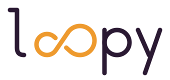

<p align="center">
  <a href="https://loopy.systems/">
    <picture>
      <source media="(prefers-color-scheme: dark)" srcset="brand/loopy-wordmark-dark.svg">
      
    </picture>
  </a>
</p>

<h3 align="center">Every loop, autonomous evolution.</h3>

<p align="center">
  An open protocol for autonomous research loops.<br>
  Agents propose changes, plain code keeps only what beats the record, within a budget you set.
</p>

<p align="center">
  <a href="https://loopy.systems/">loopy.systems</a> ·
  <a href="SPEC.md">Spec</a> ·
  <a href="AGENTS.md">Agent setup</a> ·
  <a href="brand/">Brand kit</a>
</p>

---

## Start

Give this to your coding agent:

```
Read github.com/technodotventures/loopy and set up a loop that improves this project.
```

It will follow [AGENTS.md](AGENTS.md): work out what "better" means for your project, write a `loopy.yml`, add the runner, and open one pull request for you to review. Nothing runs until you merge it.

## How it works

Each cycle runs six stages. Agents do the reading, proposing, experimenting and reporting. The decision to keep or revert a change is made by plain code, never by the agent that wrote it.

| Stage | What happens |
| --- | --- |
| **Listen** | Issues, papers, releases and feedback become scored signals |
| **Propose** | The best signals become proposals with a hypothesis and a cost |
| **Prove** | An agent edits, scores and logs until it beats the current version or runs out of budget |
| **Decide** | Deterministic gates return `keep`, `revert` or `needs-human` |
| **Ship** | Kept changes merge, or wait for a code owner |
| **Report** | Sealed scores, a cycle report, and lessons for the next lap |

One file, `loopy.yml`, declares the whole loop: cadence, budget, sources, what agents may touch, what counts as better, and who approves changes to any of it.

## Guardrails

- **Humans own the scorer.** Agents can never edit the evaluators, gates, budget or manifest.
- **Budgets are hard caps** per experiment, per cycle and per day.
- **Every change has a reason**, linked back to the signals that caused it.
- **Draft PRs only, no auto-merge by default.** Branch protection and code owners enforce it, even if Loopy has a bug.
- **No third-party product required.** A git repo and cron are enough. GitHub Agentic Workflows, Claude Code and Codex plug in as adapters.

## What's in this repo

| Path | What it is |
| --- | --- |
| [`SPEC.md`](SPEC.md) | The protocol, v0.1 |
| [`AGENTS.md`](AGENTS.md) | Step-by-step setup for coding agents |
| [`schema/`](schema/) | JSON Schemas for `loopy.yml`, the records and the public feed |
| [`templates/`](templates/) | Starter `loopy.yml`, the `.loopy/` folder, stage prompts, gh-aw workflows, labels |
| [`tools/`](tools/) | `validate.py` (manifest check) and `decide.py` (the reference keep-or-revert gate) |
| [`brand/`](brand/) | Wordmark, icon and badges |
| [`docs/`](docs/) | The website |

## Autonomously improving with Loopy

| Project | What it is | Cadence |
| --- | --- | --- |
| Smartware | The memory and context layer for software | Weekly |
| expresso | The language for agents that act | Weekly |

Running Loopy on your project? Add a badge:

```markdown
[](https://github.com/technodotventures/loopy)
```

More badges in [`brand/`](brand/).

## Status

v0.1 is a draft spec with schemas, templates and a reference gate. The `loopy` CLI lands in v0.2. See the [roadmap](SPEC.md#13-roadmap).

Requests and ideas are welcome: open an issue with the **Loopy request** form and the loop will pick it up.

## Licence

[Apache-2.0](LICENSE). Built by [Techno Ventures](https://techno.ventures).
