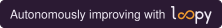
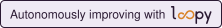
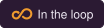
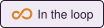

# Loopy brand kit

The full kit, with construction notes and the colour and type specimens, is at [loopy.systems/brand](https://loopy.systems/brand/).

## Badges

For projects that run Loopy. Each one links back to this repo.

| Badge | For | File |
| --- | --- | --- |
|  | light backgrounds | `badges/improving-dark.svg` |
|  | dark backgrounds | `badges/improving-light.svg` |
|  | light backgrounds, tight spots | `badges/in-the-loop-dark.svg` |
|  | dark backgrounds, tight spots | `badges/in-the-loop-light.svg` |

**Markdown** (READMEs):

```markdown
[](https://github.com/technodotventures/loopy)
```

**HTML** (websites):

```html
<a href="https://github.com/technodotventures/loopy"></a>
```

Say "autonomously improving with Loopy", not "powered by". Keep the wording as it is and don't recolour the loop.

## Marks

| File | Use |
| --- | --- |
| `loopy-wordmark-light.svg` | The wordmark on light backgrounds |
| `loopy-wordmark-dark.svg` | The wordmark on dark backgrounds |
| `loopy-icon.svg` | The loop on its own: favicons, avatars, small spaces |
| `loopy-icon-tile.svg` | App icon and social avatar, 512 × 512 |

The wordmark is "loopy" in lower case, drawn as a single plotter line, with the "oo" as an amber infinity loop. The second lobe is bigger than the first, and the line breaks where it crosses. Keep clear space of at least the height of the "l" on every side. Don't redraw it in a font, add effects or put it on a busy image.

## Colour

| Name | Hex | Use |
| --- | --- | --- |
| Paper | `#EFEAF4` | Backgrounds |
| Ink | `#2B1A33` | Text, the wordmark |
| Grid | `#CFC2DD` | Graph-paper rules, borders |
| Pencil | `#857591` | Secondary text, rejected experiments |
| Amber | `#EE9A2E` | The loop, kept experiments, one accent per view |
| Red | `#D9473B` | Reverts and errors only |

## Type

- **Newsreader** for headings
- **IBM Plex Sans** for body text
- **IBM Plex Mono** for data, code and labels

All three are free on Google Fonts.

## Voice

Lab notebook meets frontier. Short, plain sentences. Numbers over adjectives. Tagline: **Built to outgrow itself.** Headline: **Every loop, a leap.**
